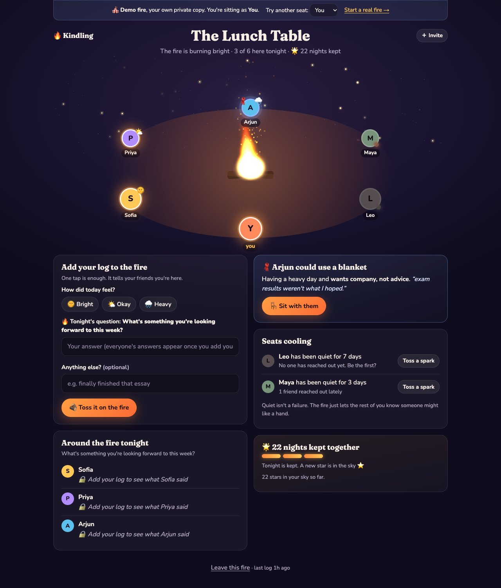

# 🔥 Kindling

**A shared campfire that keeps drifting friend groups close.**

**▶ Try it: https://kindling-chi-three.vercel.app** (tap *Try the demo fire*. No sign-up needed.)



Friendships rarely end. They drift. You change schools, a season ends, someone moves away. Nobody decides to stop
talking; everyone just assumes someone else will text first. Group chats are loud, but they never notice who went quiet.

Kindling gives a small friend group (up to 12) one campfire. Each friend has a seat around it.

| | |
|---|---|
| 🪵 **One tap a night** | Say how today felt (bright / okay / heavy) and answer a silly nightly question. Everyone's answers stay hidden until you add yours, so everyone shares before anyone scrolls. |
| 🌫️ **Quiet seats cool down** | When a friend goes quiet, their seat fades from glowing to cooling to embers. Instead of guilting the quiet friend, the fire nudges *everyone else*: "Maya has been quiet for 4 days. No one has reached out yet. Be the first?" |
| ✨ **Sparks, no reply needed** | One-tap notes like "Saved your seat by the fire" or "Thinking of you. No reply needed." They fly across the fire to the friend's seat and wait for them: "While you were away, 2 sparks landed by your seat." You can also send them as a text. |
| 🧣 **Heavy days, named needs** | A heavy log asks what would help: *company, not advice* · *distract me* · *I'd like to talk* · *just letting you know*. Friends get a matching button (🪑 Sit with them, 🎈 Send a distraction, 💬 Offer to talk) so nobody has to guess. |
| 🌟 **A shared streak** | A night counts as kept when half the circle logs. The streak belongs to the group, so nobody gets blamed for breaking it. Every kept night adds a star to the sky above your fire. |

The fire's size is the group's warmth: it fades over about a day and a half after each check-in, and sparks add heat too.
Reaching out keeps the fire going as much as showing up does.

## Built to bring people closer, not keep them scrolling

- No likes, followers, feeds or public profiles. No individual streaks.
- No accounts or emails: your seat is a private token on your device. Invite-only circles.
- Sparks between other people stay private. You only see *that* someone reached out ("2 friends reached out lately"), never what they said.
- **Leave this fire** deletes everything you wrote.
- Heavy days show a gentle pointer to [findahelpline.com](https://findahelpline.com): Kindling is for friends, not emergencies.

## How it works

- **Next.js 16** (App Router, React 19, TypeScript) for the pages and API routes.
- **Turso** (hosted SQLite, via `@libsql/client`) in production, a local SQLite file in development.
- **Canvas 2D particle fire** (`src/components/FireCanvas.tsx`): additive-blended flame puffs pulled towards the centre so they form tongues, drifting embers, one star per kept night, and spark "flights" along a curve to a friend's seat. It respects `prefers-reduced-motion`.
- **The fire's rules** are pure functions in `src/lib/fire.ts` (seat cooling, warmth, the nights-kept streak, nudges), covered by tests in `tests/fire.test.ts`.
- The **demo** (`/api/demo`) makes each visitor a private copy of "The Lunch Table", a fire with three weeks of history. You can switch seats to see it from Maya's or Arjun's side.

```bash
npm install
npm run dev        # http://localhost:3000 (uses ./kindling.db)
npm test           # fire rules
npm run typecheck
```

To deploy, set `TURSO_DATABASE_URL` and `TURSO_AUTH_TOKEN` (see `.env.example`). Tables are created on first request.

## AI use

I designed and built Kindling with Claude (Anthropic) as a coding assistant. It helped write code and run the tests and browser checks, and I reviewed and tested everything.
See [SUBMISSION.md](SUBMISSION.md) for the full disclosure.

Made for the CSC Winter Sparkathon. MIT licensed.
